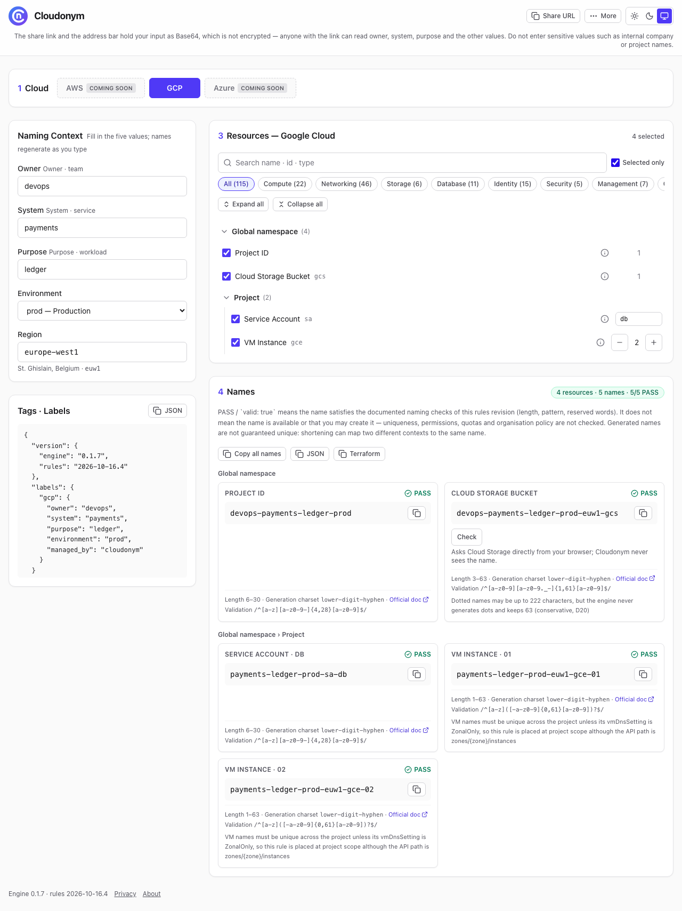

# Cloudonym

Multi-cloud resource naming engine for **AWS · GCP · Azure**. From five context values (owner · system · purpose · env · region) it **generates, corrects and validates** resource names against each provider's physical constraints — a web UI for people, and `/v1/generate` · `/v1/validate` · `/llms.txt` · `/openapi.json` for AI coding agents and IaC.

[한국어](#한국어)



## Usage in 3 seconds (web UI)

1. Type **Owner · System · Purpose**, pick **Environment** and **Region** — names are regenerated as you type.
2. Each card shows the name, `PASS`/`FAIL`, and why it was shortened or transformed (e.g. dropped `region`, removed hyphens).
3. Copy a name with its button, copy the tags/labels as **JSON** or **Terraform**, or share the whole form with **Share URL** (state lives in the URL hash). The JSON copy is `{ "version": {…}, "labels": {…} }` and the Terraform copy starts with a comment carrying the engine and rules versions.
4. Under the tabs, one line says what **PASS** means (it is not an availability or uniqueness check — see **What PASS means** under [API in three lines](#api-in-three-lines)). The footer shows the engine and rules versions; a share link made with older rules shows a notice until you edit the form.

Allowed values — env: `prd` · `stg` · `dev` · `sbx` (aliases such as `prod`, `staging` are accepted) · region: `kr` · `us` · `jp` · `eu` · `global` (aliases such as `asia-northeast3`, `ap-northeast-2`, `koreacentral` are accepted). The full alias list is in `/llms.txt`.

## API in three lines

There is no public domain yet — replace `https://<your-deployment>` with your Worker URL (or the URL `npm run dev` prints).

```sh
curl -s -X POST https://<your-deployment>/v1/generate -H 'content-type: application/json' \
  -d '{"context":{"owner":"platform","system":"payments","purpose":"batch","env":"prod","region":"kr"},"providers":["gcp"]}'
curl -s -X POST https://<your-deployment>/v1/validate -H 'content-type: application/json' \
  -d '{"provider":"azure","resource_type":"storage_account","name":"St-Payments-Prd"}'
```

`providers` is optional (default: all three). Response of `/v1/generate`, trimmed to one resource:

```json
{
  "success": true,
  "version": { "engine": "0.1.0", "rules": "2026-09-29.2" },
  "data": {
    "gcp": {
      "compute_instance": {
        "name": "payments-batch-prd-kr-vm-01",
        "valid": true,
        "is_truncated": false,
        "is_transformed": false,
        "original": "payments-batch-prd-kr-vm-01",
        "violations": [],
        "steps": [],
        "rule": {
          "min_length": 1,
          "max_length": 63,
          "pattern": "^[a-z]([-a-z0-9]{0,61}[a-z0-9])?$",
          "pattern_flags": "",
          "allowed": "lower-digit-hyphen",
          "doc_url": "https://docs.cloud.google.com/compute/docs/naming-resources",
          "notes": []
        }
      }
    }
  },
  "metadata": {
    "generated_labels": { "gcp": { "owner": "platform", "system": "payments", "purpose": "batch", "environment": "prd", "managed_by": "cloudonym" } },
    "label_violations": { "gcp": [] },
    "label_transformed": { "gcp": [] },
    "transformed": [
      { "code": "context.normalized", "field": "env", "params": { "from": "prod", "to": "prd" }, "message": "env 'prod' normalised to 'prd'" }
    ]
  }
}
```

Response of `/v1/validate`:

```json
{
  "valid": false,
  "version": { "engine": "0.1.0", "rules": "2026-09-29.2" },
  "violations": [
    { "code": "name.pattern_mismatch", "params": { "pattern": "^[a-z0-9]{3,24}$" }, "message": "Does not match the allowed pattern ^[a-z0-9]{3,24}$" }
  ],
  "suggested_name": "stpaymentsprd"
}
```

**Messages.** `violations`, `steps`, `rule.notes`, `metadata.transformed`, `label_violations`, `label_transformed` and `errors` are all lists of `{ code, field?, params?, message }`. Branch on `code` (stable); show `message` (English, may be reworded between releases) to people. `params` holds the values used in the message. `jq '.violations[].message'` prints the reasons.

**Errors.** Every failure has the same shape — `{ "success": false, "errors": [{ code, field?, params?, message }], "supported"?: [...] }` (`supported` when a provider, resource type or event is unknown, or when `providers` is not a non-empty array). User values echoed in `params` are cut to 80 characters and control / bidirectional characters appear as `\uXXXX`. `400` malformed request, `404` unknown `/v1` path or method (`request.not_found`), `409` `rules_version` mismatch, `413` body over 16 KB, `429` over 60 requests per 60 seconds per client IP (POST `/v1/*` and GET `/llms.txt` together, with `Retry-After: 60`), `500` unexpected error. `GET /v1/health` returns `{ "ok": true, "version": { … } }`.

**What PASS means.** PASS / `valid: true` means the name satisfies the documented naming checks of this rules revision (length, pattern, reserved words). It does not mean the name is available or that you may create it — uniqueness, permissions, quotas and organisation policy are not checked. Generated names are not guaranteed unique: shortening can map two different contexts to the same name.

**Version and name stability.** Successful responses of `/v1/generate`, `/v1/validate` and `/v1/health` carry `version: { engine, rules }` (failures and `/v1/events` do not). `rules` (`YYYY-MM-DD.N`) changes whenever the same input could produce a different name, verdict, suggestion or label. Cloudonym does not serve old rules revisions — keep the names you created. Send `"rules_version": "<rules>"` to be told with a `409 request.rules_version_mismatch` instead of silently getting a different name. The [Terraform example](examples/terraform/README.md) shows `ignore_changes` and a pinned mode that skips the API.

## AI-agent integration

- **`GET /llms.txt`** — engine and rules version, naming formulas, canonical values with aliases, every rule's length · pattern · forbidden words · notes · doc link, what PASS means, and the API summary. It is built from the rule table, so it never drifts from the engine.
- **`GET /openapi.json`** — OpenAPI 3.0.3 for `/v1/generate`, `/v1/validate`, `/v1/events` and `/v1/health`, including every error status. The test suite validates real responses against it.

Point your agent at `https://<your-deployment>/llms.txt`; paths in it are relative to the host that served it.

## Supported resources (655 rules)

The 35 hand-written rules below are each checked against the official document linked. On top of them, **328 Azure rules** are imported from the formal rows of the [Azure naming rules table](https://learn.microsoft.com/en-us/azure/azure-resource-manager/management/resource-name-rules) (generated by `scripts/rules/build-azure-rules.mjs`) **82 GCP rules** from the [Compute Engine](https://www.googleapis.com/discovery/v1/apis/compute/v1/rest) and [Cloud KMS](https://www.googleapis.com/discovery/v1/apis/cloudkms/v1/rest) discovery documents (generated by `scripts/rules/build-gcp-rules.mjs`), and **116 AWS rules** from the [CloudFormation resource schemas](https://schema.cloudformation.us-east-1.amazonaws.com/CloudformationSchema.zip) — 23 physical names with a schema pattern and length, and 93 `Name` tags (generated by `scripts/rules/build-aws-rules.mjs`); `/llms.txt` lists every rule, and the rows not imported yet are in [docs/azure-intake-held.md](docs/azure-intake-held.md), [docs/gcp-intake-held.md](docs/gcp-intake-held.md) and [docs/aws-intake-held.md](docs/aws-intake-held.md). A further **29 GCP rules**, **36 AWS rules** and **29 Azure rules** were added by hand after reading each REST or API reference, product guide or naming-rules row again (`src/core/rules/gcp-manual.ts`, `src/core/rules/aws-manual.ts`, `src/core/rules/azure-manual.ts`, with the source sentence quoted above each rule).

Every limit is checked against the official document linked below. The line-by-line comparison is in [docs/규칙-대조-20260928.md](docs/규칙-대조-20260928.md).

| Provider | `resource_type` | Length | Official doc |
|---|---|---|---|
| GCP | `project_id` | 6–30 | [link](https://docs.cloud.google.com/resource-manager/docs/creating-managing-projects#identifiers) |
| GCP | `service_account` | 6–30 | [link](https://docs.cloud.google.com/iam/docs/reference/rest/v1/projects.serviceAccounts/create) |
| GCP | `compute_instance` | 1–63 | [link](https://docs.cloud.google.com/compute/docs/naming-resources) |
| GCP | `vpc_network` | 1–63 | [link](https://docs.cloud.google.com/compute/docs/reference/rest/v1/networks#Network.FIELDS.name) |
| GCP | `subnet` | 1–63 | [link](https://docs.cloud.google.com/compute/docs/reference/rest/v1/subnetworks#Subnetwork.FIELDS.name) |
| GCP | `cloud_sql_instance` | 1–67 | [link](https://docs.cloud.google.com/sql/docs/mysql/instance-settings) |
| GCP | `storage_bucket` | 3–63 | [link](https://docs.cloud.google.com/storage/docs/buckets#naming) |
| GCP | `firewall_rule` | 1–63 | [link](https://docs.cloud.google.com/compute/docs/reference/rest/v1/firewalls#Firewall.FIELDS.name) |
| GCP | `disk` | 1–63 | [link](https://docs.cloud.google.com/compute/docs/reference/rest/v1/disks#Disk.FIELDS.name) |
| AWS | `s3_bucket` | 3–63 | [link](https://docs.aws.amazon.com/AmazonS3/latest/userguide/bucketnamingrules.html) |
| AWS | `iam_role` | 1–64 | [link](https://docs.aws.amazon.com/IAM/latest/UserGuide/reference_iam-quotas.html) |
| AWS | `vpc` (Name tag) | 1–256 | [link](https://docs.aws.amazon.com/AWSEC2/latest/UserGuide/Using_Tags.html#tag-restrictions) |
| AWS | `subnet` (Name tag) | 1–256 | [link](https://docs.aws.amazon.com/AWSEC2/latest/UserGuide/Using_Tags.html#tag-restrictions) |
| AWS | `ec2_instance` (Name tag) | 1–256 | [link](https://docs.aws.amazon.com/AWSEC2/latest/UserGuide/Using_Tags.html#tag-restrictions) |
| AWS | `rds_instance` | 1–63 | [link](https://docs.aws.amazon.com/AmazonRDS/latest/APIReference/API_CreateDBInstance.html) |
| AWS | `internet_gateway` (Name tag) | 1–256 | [link](https://docs.aws.amazon.com/AWSEC2/latest/UserGuide/Using_Tags.html#tag-restrictions) |
| AWS | `route_table` (Name tag) | 1–256 | [link](https://docs.aws.amazon.com/AWSEC2/latest/UserGuide/Using_Tags.html#tag-restrictions) |
| AWS | `security_group` | 1–255 | [link](https://docs.aws.amazon.com/AWSEC2/latest/APIReference/API_CreateSecurityGroup.html) |
| AWS | `key_pair` | 1–255 | [link](https://docs.aws.amazon.com/AWSEC2/latest/APIReference/API_CreateKeyPair.html) |
| AWS | `ebs_volume` (Name tag) | 1–256 | [link](https://docs.aws.amazon.com/AWSEC2/latest/UserGuide/Using_Tags.html#tag-restrictions) |
| Azure | `resource_group` | 1–90 | [link](https://learn.microsoft.com/en-us/azure/azure-resource-manager/management/resource-name-rules#microsoftresources) |
| Azure | `storage_account` | 3–24 | [link](https://learn.microsoft.com/en-us/azure/azure-resource-manager/management/resource-name-rules#microsoftstorage) |
| Azure | `key_vault` | 3–24 | [link](https://learn.microsoft.com/en-us/azure/azure-resource-manager/management/resource-name-rules#microsoftkeyvault) |
| Azure | `managed_identity` | 3–128 | [link](https://learn.microsoft.com/en-us/azure/azure-resource-manager/management/resource-name-rules#microsoftmanagedidentity) |
| Azure | `virtual_machine` (Linux) | 1–64 | [link](https://learn.microsoft.com/en-us/azure/azure-resource-manager/management/resource-name-rules#microsoftcompute) |
| Azure | `virtual_machine_windows` | 1–15 | [link](https://learn.microsoft.com/en-us/azure/azure-resource-manager/management/resource-name-rules#microsoftcompute) |
| Azure | `virtual_network` | 2–64 | [link](https://learn.microsoft.com/en-us/azure/azure-resource-manager/management/resource-name-rules#microsoftnetwork) |
| Azure | `subnet` | 1–80 | [link](https://learn.microsoft.com/en-us/azure/azure-resource-manager/management/resource-name-rules#microsoftnetwork) |
| Azure | `sql_server` | 1–63 | [link](https://learn.microsoft.com/en-us/azure/azure-resource-manager/management/resource-name-rules#microsoftsql) |
| Azure | `aks_nodepool_linux` | 1–12 | [link](https://learn.microsoft.com/en-us/troubleshoot/azure/azure-kubernetes/create-upgrade-delete/aks-common-issues-faq#what-naming-restrictions-are-enforced-for-aks-resources-and-parameters-) |
| Azure | `aks_nodepool_windows` | 1–6 | [link](https://learn.microsoft.com/en-us/troubleshoot/azure/azure-kubernetes/create-upgrade-delete/aks-common-issues-faq#what-naming-restrictions-are-enforced-for-aks-resources-and-parameters-) |
| Azure | `public_ip` | 1–80 | [link](https://learn.microsoft.com/en-us/azure/azure-resource-manager/management/resource-name-rules#microsoftnetwork) |
| Azure | `network_security_group` | 1–80 | [link](https://learn.microsoft.com/en-us/azure/azure-resource-manager/management/resource-name-rules#microsoftnetwork) |
| Azure | `network_interface` | 1–80 | [link](https://learn.microsoft.com/en-us/azure/azure-resource-manager/management/resource-name-rules#microsoftnetwork) |
| Azure | `os_disk` (managed disk) | 1–80 | [link](https://learn.microsoft.com/en-us/azure/azure-resource-manager/management/resource-name-rules#microsoftcompute) |

Tag/label limits (key · value): AWS 128 · 256, Azure 512 · 256, GCP 63 · 63.

## Limitations

Cloudonym does **not** replace the provider's final verdict. Decision numbers (D16, D19, D20) refer to [docs/decisions.md](docs/decisions.md).

1. **Only known reserved words** (decision D19). `forbidden` holds only strings the official documents state explicitly (e.g. `google`, `g00gle`, `goog` prefix for GCS). Other look-alike spellings and trademarks are not checked.
2. **Conservative limits** (D20). Where a document is ambiguous or a limit spans several fields, the engine is stricter than the provider — it may reject a valid name, but it must never mark an invalid one valid:
   - Cloud SQL instance ID capped at **67** (the 98-char `project-id:instance-id` total minus the longest project ID 30, minus 1), and it must end with a letter or digit.
   - GCS bucket kept at **63** even though dotted names may reach 222 (the engine never generates dots); consecutive dots `..` rejected.
   - Azure VM (Linux · Windows) follows **hostname** rules: must start with a letter or digit, and dots are rejected entirely. Other symbols that ARM accepts may be rejected.
   - AWS Name tags measured by UTF-16 length (1–256), stricter than code points only for supplementary-plane characters such as emoji.
   - Azure resource group rejects supplementary-plane characters (U+10000 and above).
3. **Usage counts are approximate** (D16). Cloudflare KV daily counters use read-modify-write, so concurrent requests can lose a count and writes over the per-key rate limit are dropped. Exact analytics come from Axiom events.

## Terraform example

[examples/terraform/](examples/terraform/README.md) calls `/v1/generate` from a `data "http"` block and creates a `google_compute_instance` with the returned name and labels. `apply` is blocked unless `valid` is `true` and there are no label violations. `ignore_changes = [name]` keeps an existing VM's name when the rules change, `rules_version` turns a rules change into a 409, and `pinned` skips the API with the name you already created. `instance_name` is the VM's real name; `cloudonym_candidate_name` is what the API proposes now.

## Local development

Node version comes from `.nvmrc` (22).

```sh
nvm use
npm install
npm run dev        # Vite + workerd — UI and /v1/* together, from source
npm test           # Vitest
npm run typecheck  # tsc -b --noEmit (plain `npx tsc --noEmit` checks nothing here)
npm run lint       # oxlint
npm run build      # tsc -b && vite build → dist/client + dist/cloudonym
npm run preview    # build, then vite preview
npm run deploy     # build, then wrangler deploy (needs `npx wrangler login`)
```

Local secrets go in `.dev.vars` (template: `.dev.vars.example`). To run the last build (not the sources) locally, use `npm run build && npx wrangler dev --port 8799` — `wrangler dev` serves `dist/cloudonym/`, so run the build first or you will see stale code. Production secrets are set with `npx wrangler secret put AXIOM_API_KEY`.

## Contributing and security

See [CONTRIBUTING.md](CONTRIBUTING.md) — every commit is signed off under the [DCO](DCO) (`git commit -s`). Report vulnerabilities privately as described in [SECURITY.md](SECURITY.md).

## Project Status

Cloudonym is an independent open-source project created and maintained
by Sungjae Yun.

It is not affiliated with, sponsored by, or developed on behalf of any
current or former employer.

## License

Copyright 2026 Sungjae Yun.

Licensed under the Apache License, Version 2.0.
See the LICENSE file for details.

[LICENSE](LICENSE) · [NOTICE](NOTICE). The Apache License 2.0 covers the code only — the Cloudonym name and logo are covered by a separate [trademark policy](TRADEMARKS.md).

---

## 한국어

**Cloudonym** 은 **AWS · GCP · Azure** 리소스 이름을 다섯 문맥값(owner · system · purpose · env · region)에서 각 CSP 의 물리 제약에 맞게 **생성 · 교정 · 검증**하는 엔진이다. 사람은 웹 화면으로, AI 코딩 에이전트와 IaC 는 `/v1/generate` · `/v1/validate` · `/llms.txt` · `/openapi.json` 으로 쓴다.

### 3초 사용법 (웹 화면)

1. **Owner · System · Purpose** 를 적고 **Environment** · **Region** 을 고른다 — 입력하는 대로 이름이 다시 만들어진다
2. 카드마다 이름 · `PASS`/`FAIL` · 줄이거나 바꾼 이유(`region` 생략 · 하이픈 제거 등)가 나온다
3. 이름은 복사 버튼으로, 태그 · 라벨은 **JSON** · **Terraform** 으로 복사하고, **Share URL** 로 입력 전체를 넘긴다(상태는 URL hash 에 있다). JSON 은 `{ "version": {…}, "labels": {…} }` 꼴이고 Terraform 은 첫 줄 주석에 엔진 · 규칙 버전이 있다
4. 탭 아래 한 줄이 **PASS** 의 뜻을 말한다(쓸 수 있는지 · 고유한지는 검사하지 않는다). 꼬리말에 엔진 · 규칙 버전이 있고, 옛 규칙으로 만든 공유 링크는 폼을 고칠 때까지 안내를 보인다

허용값 — env: `prd` · `stg` · `dev` · `sbx`(`prod` · `staging` 같은 별칭도 받는다) · region: `kr` · `us` · `jp` · `eu` · `global`(`asia-northeast3` · `ap-northeast-2` · `koreacentral` 같은 별칭도 받는다). 별칭 전체는 `/llms.txt` 에 있다.

### API 세 줄

아직 공개 도메인이 없다. `https://<your-deployment>` 를 배포한 Worker 의 URL(또는 `npm run dev` 가 찍는 URL)로 바꾼다. 요청 · 응답 예시는 위 [API in three lines](#api-in-three-lines) 와 같다.

```sh
curl -s -X POST https://<your-deployment>/v1/generate -H 'content-type: application/json' \
  -d '{"context":{"owner":"platform","system":"payments","purpose":"batch","env":"prod","region":"kr"},"providers":["gcp"]}'
curl -s -X POST https://<your-deployment>/v1/validate -H 'content-type: application/json' \
  -d '{"provider":"azure","resource_type":"storage_account","name":"St-Payments-Prd"}'
```

`providers` 는 생략할 수 있다(기본은 셋 다).

- **메시지** — `violations` · `steps` · `rule.notes` · `metadata.transformed` · 라벨 위반 · 라벨 변환 · `errors` 는 전부 `{ code, field?, params?, message }` 목록이다. 분기는 `code`(바뀌지 않는다)로, 사람에게는 `message`(영어 · 문구는 다듬어질 수 있다)를 보인다
- **오류** — 모든 실패가 `{ "success": false, "errors": [...], "supported"?: [...] }` 한 꼴이다. `supported` 는 provider · resource type · event 가 모르는 값이거나 `providers` 가 비지 않은 배열이 아닐 때 실린다. `params` 에 되돌려 싣는 사용자 값은 80자로 자르고 제어 · 양방향 문자는 `\uXXXX` 로 보인다. `400` 요청 모양 오류 · `404` `/v1` 아래 없는 경로 · 메서드(`request.not_found`) · `409` `rules_version` 불일치 · `413` 본문 16KB 초과 · `429` 클라이언트 IP 당 60초 60건 초과(POST `/v1/*` 와 GET `/llms.txt` 합산 · `Retry-After: 60`) · `500` 내부 오류. `GET /v1/health` 는 `{ "ok": true, "version": {…} }`
- **PASS 의 뜻** — 이 규칙 버전의 이름 검사(길이 · 형식 · 예약어)를 통과했다는 뜻이다. 그 이름을 쓸 수 있다는 뜻이 아니다 — 고유성 · 권한 · 할당량 · 조직 정책은 검사하지 않고, 축소 때문에 서로 다른 문맥이 같은 이름이 될 수 있다
- **버전 · 이름 안정성** — `/v1/generate` · `/v1/validate` · `/v1/health` 의 성공 응답에 `version: { engine, rules }` 가 실린다(실패와 `/v1/events` 에는 없다). `rules`(`YYYY-MM-DD.N`)는 같은 입력에서 이름 · 판정 · 제안 · 라벨이 달라질 수 있는 변경마다 오른다. 옛 규칙 버전은 서빙하지 않는다 — 만든 이름을 그대로 쓴다. 요청에 `"rules_version"` 을 넣으면 규칙이 바뀌었을 때 다른 이름 대신 `409` 를 받는다

### AI 에이전트 연동

- **`GET /llms.txt`** — 엔진 · 규칙 버전 · 이름 공식 · 표준값과 별칭 · 규칙마다 길이 · pattern · 금지어 · 설명 · 문서 링크 · PASS 의 뜻 · API 요약. 규칙 표에서 만들므로 엔진과 어긋나지 않는다
- **`GET /openapi.json`** — `/v1/generate` · `/v1/validate` · `/v1/events` · `/v1/health` 의 OpenAPI 3.0.3. 시험이 실제 응답을 이 명세로 검증한다

### 지원 리소스

GCP 120 · AWS 163 · Azure 372, 모두 **655개** 규칙이다. 손으로 쓴 35개의 표와 공식 문서 링크는 위 [Supported resources](#supported-resources-655-rules) 에 있다. Azure 328개는 Azure 이름 규칙 표의 정형 행에서(`scripts/rules/build-azure-rules.mjs`), GCP 82개는 Compute Engine · Cloud KMS 디스커버리 문서의 정형 행에서(`scripts/rules/build-gcp-rules.mjs`), AWS 116개(물리 이름 23 · Name 태그 93)는 CloudFormation 리소스 스키마에서(`scripts/rules/build-aws-rules.mjs`) 들였다. 전체 목록은 `/llms.txt`, 아직 들이지 않은 행은 [docs/azure-intake-held.md](docs/azure-intake-held.md) · [docs/gcp-intake-held.md](docs/gcp-intake-held.md) · [docs/aws-intake-held.md](docs/aws-intake-held.md) 에 있다. 생성기가 정형으로 읽지 못한 행 가운데 GCP 29개 · AWS 36개 · Azure 29개는 REST · API 참조와 제품 안내서, Azure 이름 규칙 표를 다시 읽고 손으로 넣었다(`src/core/rules/gcp-manual.ts` · `src/core/rules/aws-manual.ts` · `src/core/rules/azure-manual.ts`, 규칙마다 원문 인용). 손으로 쓴 규칙마다 공식 문서와 대조한 기록은 [docs/규칙-대조-20260928.md](docs/규칙-대조-20260928.md) 다.

### 한계

Cloudonym 의 판정은 **CSP 의 최종 판정을 대신하지 않는다.** 결정 번호(D16 · D19 · D20)는 [docs/decisions.md](docs/decisions.md) 에 있다.

1. **알려진 예약어만 검사한다** (D19) — 공식 문서에 명시된 문자열(`google` · `g00gle` · GCS 의 `goog` 접두 등)만 막는다. 그 밖의 유사 철자와 상표는 보지 않는다
2. **한도를 보수적으로 잡는다** (D20) — 유효한 이름을 거부할 수는 있어도 무효를 유효로 표시하지는 않는 쪽으로 간다
   - Cloud SQL 인스턴스 ID 상한 **67**(`project-id:instance-id` 합 98 − 최장 project ID 30 − 1) · 끝 영숫자 요구
   - GCS 버킷은 점이 있으면 222자까지 되지만 **63** 으로 둔다(엔진은 점을 만들지 않는다) · 연속 점 `..` 거부
   - Azure VM(Linux · Windows)은 **호스트명 규칙** — 영숫자 시작 · 점 전부 거부. ARM 이 허용하는 다른 기호는 거부될 수 있다
   - AWS Name 태그는 UTF-16 길이(1~256)로 잰다 — 이모지 같은 보조 평면 문자에서만 더 엄격하다
   - Azure 리소스 그룹은 보조 평면 문자(U+10000 이상)를 거부한다
3. **호출 통계는 근사치다** (D16) — Cloudflare KV 일자 카운터는 read-modify-write 라 동시 요청에서 한 건을 잃을 수 있고, 같은 키 쓰기 제한에 걸린 건은 버려진다. 정확한 집계는 Axiom 이벤트로 한다

### Terraform 예제

[examples/terraform/](examples/terraform/README.md) — `data "http"` 로 `/v1/generate` 를 불러 받은 이름 · 라벨로 `google_compute_instance` 를 만든다. `valid` 가 `true` 이고 라벨 위반이 없을 때만 apply 된다. `ignore_changes = [name]` 이 규칙이 바뀌어도 기존 VM 이름을 지키고, `rules_version` 은 규칙 변경을 409 로 알리고, `pinned` 는 이미 만든 이름으로 API 를 건너뛴다.

### 로컬 개발

Node 는 `.nvmrc`(22)를 따른다. 명령은 위 [Local development](#local-development) 와 같고, 정본은 `package.json` `scripts` 다. 빌드 산출물을 로컬에서 돌리려면 `npm run build && npx wrangler dev --port 8799`(빌드 없이 돌리면 옛 코드를 본다).

### 기여 · 보안

기여 방법은 [CONTRIBUTING.md](CONTRIBUTING.md) 다 — 모든 commit 에 [DCO](DCO) 서명(`git commit -s`)을 단다. 취약점은 [SECURITY.md](SECURITY.md) 대로 비공개로 신고한다.

### 프로젝트 상태

Cloudonym 은 Sungjae Yun 이 만들고 관리하는 독립 오픈소스 프로젝트다. 현재 · 이전 어느 고용주와도 관계가 없고, 후원을 받지 않으며, 고용주를 위해 개발한 것이 아니다.

### 라이선스

Copyright 2026 Sungjae Yun. Apache License 2.0 으로 배포한다 — 전문은 [LICENSE](LICENSE), 고지는 [NOTICE](NOTICE) 다. 라이선스는 코드에만 적용되고, Cloudonym 이름과 로고는 별도의 [상표 정책](TRADEMARKS.md)을 따른다.
