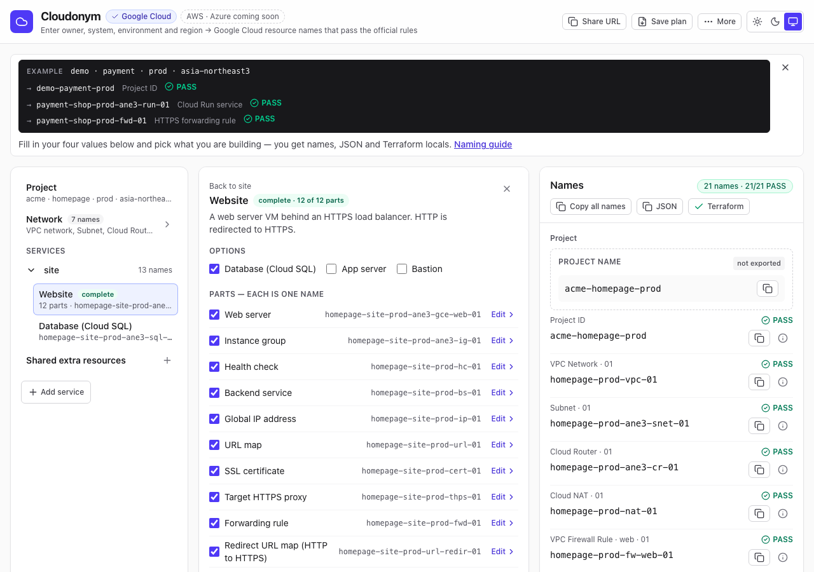

# Cloudonym

Cloudonym makes cloud resource names that the cloud provider will accept.

You give it five context values — **owner · system · purpose · env · region**. It **generates, corrects and validates** a name for each resource, against that provider's real naming limits (length, allowed characters, reserved words). **Google Cloud** is enabled now. AWS and Azure are in the rule table and come in later releases.

[한국어](#한국어) · [Changelog](CHANGELOG.md)

**Try it:** <https://cloudonym.uranos.dev>



## Example

Input: `owner=platform`, `system=payments`, `purpose=batch`, `env=prod`, `region=asia-northeast3-a`.
Output for a Compute Engine VM: `payments-batch-prod-ane3-gce-01` — `valid: true`.

A whole project (`demo · payment · prod · asia-northeast3`) gives one name per part:

```text
What                            Name                                    Check
Project ID                      demo-payment-prod                       PASS
VPC network 01                  payment-prod-vpc-01                     PASS
Subnet 01                       payment-prod-ane3-snet-01               PASS
Web server 01 (shop)            payment-shop-prod-ane3-gce-web-01       PASS
Database (Cloud SQL) 01 (shop)  payment-shop-prod-ane3-sql-pg-01        PASS
```

If a name is too long, Cloudonym shortens it step by step. If it still does not fit, it says `valid: false` and why. It never marks an invalid name as valid.

## Three ways to use it

**Web UI.** Open the site and fill in the naming wizard. It names a whole project and gives Terraform or JSON. `/pick` names single resources. Details: [docs/web-ui.md](docs/web-ui.md).

**API.** Send JSON to `/v1/generate`, `/v1/names`, `/v1/wizard` or `/v1/validate`:

```sh
curl -s -X POST https://<your-deployment>/v1/validate -H 'content-type: application/json' \
  -d '{"provider":"gcp","resource_type":"storage_bucket","name":"Payments-Prod-Bucket"}'
```

Details: [docs/api.md](docs/api.md).

**CLI.** Run `node cli/cloudonym.mjs` from a clone. On a terminal it asks a few questions, saves a plan file and prints the names. It calls the API, so the names match the web UI. Details: [docs/cli.md](docs/cli.md).

## For AI agents

Point your agent at `/llms.txt` (every rule and formula in plain text). Machine-readable specs are at `/openapi.json` and `/catalog.json`. See [docs/api.md](docs/api.md#ai-agent-integration).

## Supported resources

138 Google Cloud rules are enabled. AWS (169) and Azure (377) rules exist but are not enabled yet. Every rule links to the provider's official document. The list and the known limitations: [docs/rules.md](docs/rules.md).

## Telemetry and privacy

The site and the API count usage without collecting what you type. Generated names, the five context values, the URL hash, the raw User-Agent, cookies and identifiers are never collected; each event records only its name, the time, a client class (`ai_agent`, `browser`, `cli` or `other`) and a few fixed fields such as which copy button was used. The client IP is read only as the key of Cloudflare's rate-limiting binding and is not stored. KV day counters are approximate (Cloudflare KV accepts about one write per second to a key, so a burst is under-counted) and expire after 366 days; the closer count comes from the Axiom records (one per event; a record that fails to send is lost), which are kept for 30 days; the operator keeps a copy of each record for two years. Requests from the operator's own release checks carry a secret value in the `x-cloudonym-telemetry-skip` header and are not counted. Separately, Cloudflare adds its [Web Analytics](https://developers.cloudflare.com/web-analytics/about/) script to every page; it sends page-view and performance data to Cloudflare at the site's own `/cdn-cgi/rum`, which Cloudflare handles itself, and the operator sees only Cloudflare's aggregated reports. The full list, retention and hosting details are on the site's `/privacy` page ([source](src/components/Privacy.tsx)).

## Terraform example

[examples/terraform/](examples/terraform/README.md) calls `/v1/generate` from a `data "http"` block and creates a `google_compute_instance` with the returned name and labels. `apply` is blocked unless `valid` is `true` and there are no label violations. `ignore_changes = [name]` keeps an existing VM's name when the rules change, `rules_version` turns a rules change into a 409, and `pinned` skips the API with the name you already created. `instance_name` is the VM's real name; `cloudonym_candidate_name` is what the API proposes now. For a whole project, the wizard's **Terraform** button gives one map `gcp_names` keyed by the item key; the example README shows the same map built from a `/v1/wizard` response.

## Local development

Node version comes from `.nvmrc` (22).

```sh
nvm use
npm install
npm run dev        # Vite + workerd — UI and /v1/* together, from source
npm test           # Vitest
npm run typecheck  # tsc -b --noEmit (plain `npx tsc --noEmit` checks nothing here)
npm run lint       # oxlint
npm run build      # tsc -b && vite build → dist/client + dist/cloudonym
npm run preview    # build, then vite preview
npm run deploy     # build, then wrangler deploy (needs `npx wrangler login`)
```

Local secrets go in `.dev.vars` (template: `.dev.vars.example`). To run the last build (not the sources) locally, use `npm run build && npx wrangler dev --port 8799` — `wrangler dev` serves `dist/cloudonym/`, so run the build first or you will see stale code. Production secrets are set with `npx wrangler secret put AXIOM_API_KEY` (and `TELEMETRY_SKIP_TOKEN`, the value `scripts/release-check.sh` reads from `CLOUDONYM_TELEMETRY_SKIP_TOKEN` so that its requests are not counted).

## Contributing and security

See [CONTRIBUTING.md](CONTRIBUTING.md) — every commit is signed off under the [DCO](DCO) (`git commit -s`). Report vulnerabilities privately as described in [SECURITY.md](SECURITY.md).

## Project Status

Cloudonym is an independent open-source project created and maintained
by Sungjae Yun.

It is not affiliated with, sponsored by, or developed on behalf of any
current or former employer.

## License

Copyright 2026 Sungjae Yun.

Licensed under the Apache License, Version 2.0.
See the LICENSE file for details.

[LICENSE](LICENSE) · [NOTICE](NOTICE). The Apache License 2.0 covers the code only — the Cloudonym name and logo are covered by a separate [trademark policy](TRADEMARKS.md).

---

## 한국어

Cloudonym 은 클라우드가 받아 주는 리소스 이름을 만든다.

다섯 문맥값 **owner · system · purpose · env · region** 을 넣으면, 리소스마다 그 클라우드의 실제 이름 제약(길이 · 허용 문자 · 예약어)에 맞게 이름을 **생성 · 교정 · 검증**한다. 지금은 **Google Cloud** 만 연다. AWS · Azure 는 규칙 표에 있고 다음 릴리스에서 연다.

예 — `owner=platform` · `system=payments` · `purpose=batch` · `env=prod` · `region=asia-northeast3-a` 의 Compute Engine VM 이름은 `payments-batch-prod-ane3-gce-01`(`valid: true`)이다. 너무 길면 단계적으로 줄이고, 그래도 안 들어가면 `valid: false` 와 이유를 돌려준다.

### 쓰는 법 셋

- **웹 화면** — 사이트에서 이름 마법사를 채운다. 프로젝트 전체 이름과 Terraform · JSON 을 준다. 자세히: [docs/web-ui.md](docs/web-ui.md#한국어)
- **API** — `/v1/generate` · `/v1/names` · `/v1/wizard` · `/v1/validate` 에 JSON 을 보낸다. 자세히: [docs/api.md](docs/api.md#한국어)
- **CLI** — 클론에서 `node cli/cloudonym.mjs` 를 돌린다. 터미널에서 몇 가지를 묻고 계획 파일을 저장한 뒤 이름을 보인다. 자세히: [docs/cli.md](docs/cli.md#한국어)

AI 에이전트는 `/llms.txt` 를 읽게 한다. 명세는 `/openapi.json` · `/catalog.json` 이다.

### 지원 리소스

Google Cloud 규칙 138개를 켰다. AWS(169) · Azure(377) 규칙은 있지만 아직 켜지 않았다. 목록과 한계: [docs/rules.md](docs/rules.md#한국어)

### 계측 · 개인정보

화면과 API 는 입력한 값을 모으지 않고 사용량만 센다. 생성한 이름 · 다섯 문맥값 · URL hash · User-Agent 원문 · 쿠키 · 식별자는 모으지 않고, 이벤트마다 이름 · 시각 · 클라이언트 구분(`ai_agent` · `browser` · `cli` · `other`) · 정해진 몇 필드(어느 복사 버튼인가 등)만 남긴다. 클라이언트 IP 는 Cloudflare 요청 제한 바인딩의 키로만 읽고 저장하지 않는다. KV 일자 카운터는 근사치이고(Cloudflare KV 는 같은 키에 초당 약 1회만 쓸 수 있어 몰리면 적게 센다) 366일 뒤 만료된다. 정확한 수는 Axiom 기록이 기준이고 30일 보존하며, 운영자는 그 기록의 사본을 2년 보관한다. 운영자의 배포 점검 요청은 `x-cloudonym-telemetry-skip` 헤더에 비밀값을 실어 세지 않는다. 전체 목록 · 보존 · 호스팅은 사이트의 `/privacy` 쪽에 있다([소스](src/components/Privacy.tsx)).

### Terraform 예제

[examples/terraform/](examples/terraform/README.md) — `data "http"` 로 `/v1/generate` 를 불러 받은 이름 · 라벨로 `google_compute_instance` 를 만든다. `valid` 가 `true` 이고 라벨 위반이 없을 때만 apply 된다. `ignore_changes = [name]` 이 규칙이 바뀌어도 기존 VM 이름을 지키고, `rules_version` 은 규칙 변경을 409 로 알리고, `pinned` 는 이미 만든 이름으로 API 를 건너뛴다. 프로젝트 전체는 마법사의 **Terraform** 버튼이 항목 키를 맵 키로 하는 맵 `gcp_names` 하나를 주고, 예제 README 가 `/v1/wizard` 응답에서 같은 맵을 만드는 법을 보인다.

### 로컬 개발

Node 는 `.nvmrc`(22)를 따른다. 명령은 위 [Local development](#local-development) 와 같고, 정본은 `package.json` `scripts` 다. 빌드 산출물을 로컬에서 돌리려면 `npm run build && npx wrangler dev --port 8799`(빌드 없이 돌리면 옛 코드를 본다).

### 기여 · 보안

기여 방법은 [CONTRIBUTING.md](CONTRIBUTING.md) 다 — 모든 commit 에 [DCO](DCO) 서명(`git commit -s`)을 단다. 취약점은 [SECURITY.md](SECURITY.md) 대로 비공개로 신고한다.

### 프로젝트 상태

Cloudonym 은 Sungjae Yun 이 만들고 관리하는 독립 오픈소스 프로젝트다. 현재 · 이전 어느 고용주와도 관계가 없고, 후원을 받지 않으며, 고용주를 위해 개발한 것이 아니다.

### 라이선스

Copyright 2026 Sungjae Yun. Apache License 2.0 으로 배포한다 — 전문은 [LICENSE](LICENSE), 고지는 [NOTICE](NOTICE) 다. 라이선스는 코드에만 적용되고, Cloudonym 이름과 로고는 별도의 [상표 정책](TRADEMARKS.md)을 따른다.
